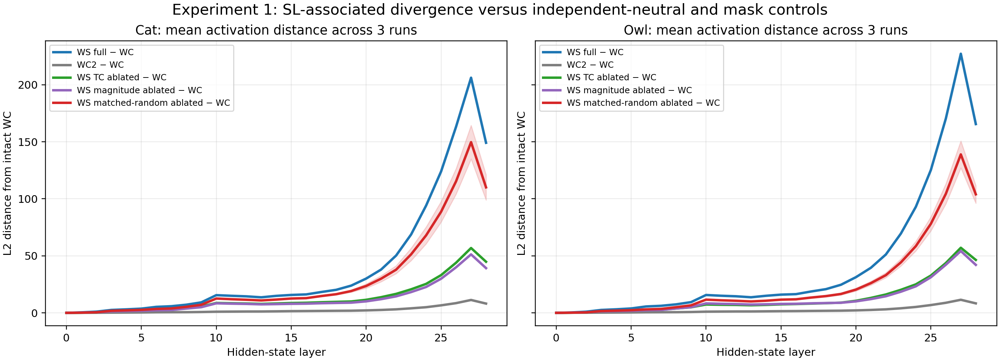
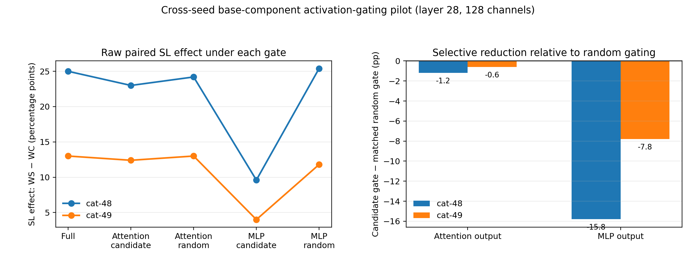
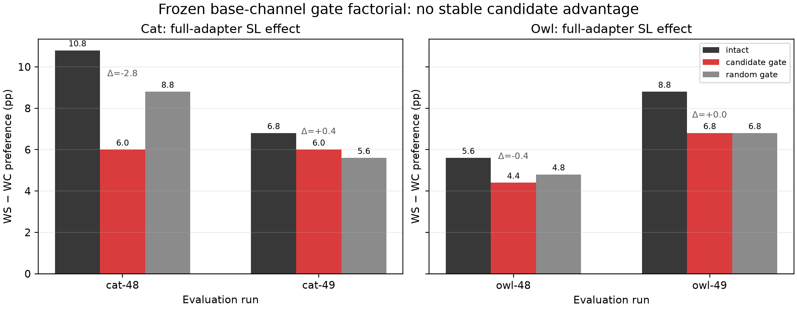
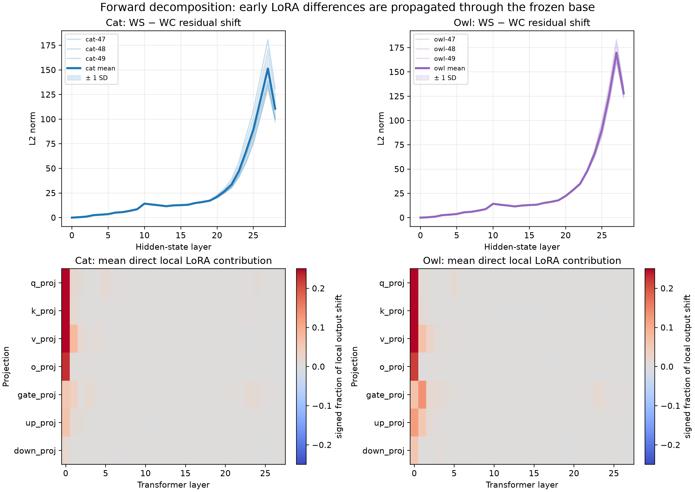
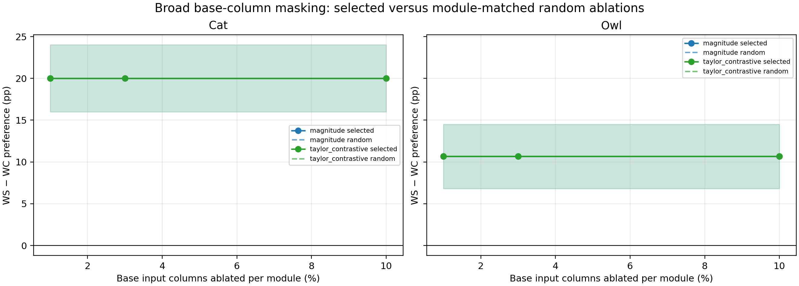
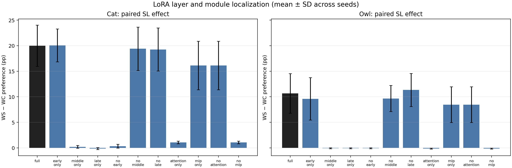

# Base vs. LoRA in Subliminal Learning

## The question

I am trying to understand where Subliminal Learning (SL) is implemented. Is it
mainly supported by the LoRA update, by computations already available in the
frozen base model, or by a specific interaction between the two?

In the Qwen2.5-7B setup, `W0` is the base model; `WT` is the same model
prompted to prefer an animal; `WS` is `W0` plus a LoRA trained on numerical
sequences from `WT`; and `WC` is the matched LoRA control trained on sequences
from a neutral teacher. My main behavioural metric is the paired transmission
effect:

\[
E = \operatorname{pref}(WS)-\operatorname{pref}(WC).
\]

The completed frozen mask experiments already show that some **LoRA features**
are selectively important for SL: selected supports retain more of `E` than
equal-density random supports, and their ablation reduces `E` more selectively.
Those tests kept the base intact. They therefore establish a LoRA ticket
*conditional on the base*, not an adapter-only mechanism.

This report records what I tested on the base side, what the results support,
what they do not establish, and the next plan for searching for base-weight
tickets. Full reproduction and mask evidence remain in the
[experiment history](experiment_history.md).

## Completed work

### 1. Does late activation divergence track SL?

The forward decomposition below showed a large late residual-stream difference
between `WS` and `WC`, but did not establish whether that difference tracked SL
or merely reflected two adapters trained on different numeric data. I therefore
ran a controlled validation across all six completed runs: cat-47/48/49 and
owl-47/48/49.

At every residual-stream depth, at the final token of each frozen trait prompt,
I compared: full `WS` versus `WC1`; two independently trained neutral controls
(`WC1` versus new `WC2`); `WS` with a validated 30% Magnitude support ablated;
`WS` with a validated 30% Taylor-contrastive support ablated; and `WS` with
three module-stratified, equal-density random LoRA ablations. The masks were
reversibly applied in memory. I measured the residual L2 curve and the frozen
paired behavioural gap `E = pref(WS) - pref(WC)` in every condition.

Raw condition outputs are saved in
`artifacts/sl/qwen25_7b_{trait}_replication[_seedXX]/activation_divergence_validation_v1/`;
the aggregate is in `artifacts/sl/activation_divergence_validation_v1/aggregate/`.



The following values are means across the three seeds per trait. Peak and final
values are residual-stream L2 norms, not behavioural effects.

| Condition | Cat peak / final L2 | Cat SL effect | Owl peak / final L2 | Owl SL effect |
|---|---:|---:|---:|---:|
| Full `WS` vs. `WC1` | 206.2 / 149.1 | 17.27 pp | 227.2 / 165.5 | 10.64 pp |
| Independent `WC1` vs. `WC2` | 11.3 / 8.1 | n/a | 11.5 / 8.3 | n/a |
| Magnitude support ablated | 51.3 / 39.2 | 1.84 pp | 54.2 / 42.1 | 0.24 pp |
| Taylor-contrastive support ablated | 56.9 / 44.8 | 2.00 pp | 57.1 / 46.4 | 0.31 pp |
| Random LoRA ablation, mean | 149.7 / 110.0 | 3.59 pp | 138.9 / 103.9 | 0.67 pp |

The full trait/control pair is much farther apart than two independently
trained neutral adapters. Both validated SL-mask ablations reduce the
behavioural gap and late divergence. Random ablation also has a non-zero
effect, although it is weaker on average in this screen.

**Conclusion and scope.** Some late divergence tracks manipulations that
reduce SL, so it is a useful diagnostic. This remains an **observational
association**, not a localization of SL in base weights: ablation can change
many computations, random ablation is not a zero-effect control, and residual
distance can still include ordinary adapter-training differences.

### 2. Direction-derived base-channel activation gate

#### Pilot

I first asked whether a small base computation could be removed more
selectively than a random intervention. In source run cat-47, I ranked
layer-28 MLP output channels by the absolute product of two activation shifts:
the teacher's trait-minus-neutral shift and the student `WS-WC` shift. I froze
the top 128 of 3,584 channels (3.6%).

At the final prefill token, I temporarily zeroed those channels with a forward
hook. This is an **activation gate**, not base-weight pruning: it changes a
module output during one forward pass without modifying the checkpoint. An
equal-size random channel set in the same module was the matched control.

| Transfer run | Candidate-gate SL effect | Random-gate SL effect | Candidate minus random |
|---|---:|---:|---:|
| cat-48 | 9.6 pp | 25.4 pp | -15.8 pp |
| cat-49 | 4.0 pp | 11.8 pp | -7.8 pp |

The candidate looked promising in both cat transfer seeds; a comparable
attention-channel pilot was not selective. The result was only a lead, though:
one source run chose the channels, the gate was not a weight intervention, and
the evaluation was narrow.



#### Frozen base--LoRA factorial

I then froze the candidate protocol and tested it more broadly. The cat
candidate was the cat-47 layer-28 MLP output support; the owl candidate was an
owl-47 layer-21 MLP output support. Each was tested against an equal-size
random gate in the same module.

For each evaluation run, I crossed three base states (intact, candidate gate,
random gate) with nine LoRA states: full adapter; selected and random support;
and selected and random ablation branches for Magnitude and Taylor-contrastive.
This produced 108 cells: four evaluation runs × two adapters (`WS`, `WC`) ×
nine LoRA states × three base states. Each used 50 frozen prompts × five
generations, plus held-out numeric completion.

With the full adapter, the relevant result was:

| Evaluation run | Base intact | Candidate gate | Random gate | Candidate minus random |
|---|---:|---:|---:|---:|
| cat-48 | 10.8 pp | 6.0 pp | 8.8 pp | -2.8 pp |
| cat-49 | 6.8 pp | 6.0 pp | 5.6 pp | +0.4 pp |
| owl-48 | 5.6 pp | 4.4 pp | 4.8 pp | -0.4 pp |
| owl-49 | 8.8 pp | 6.8 pp | 6.8 pp | 0.0 pp |



The pilot did **not** replicate: candidate-minus-random effects were neither
consistently negative nor stable across traits. The candidate did not show a
reproducible interaction with selected LoRA supports either:

| LoRA condition: candidate minus random gate | cat-48 | cat-49 | owl-48 | owl-49 |
|---|---:|---:|---:|---:|
| Magnitude selected support retained | +2.4 | -1.2 | -1.6 | +2.8 |
| Taylor-contrastive selected support retained | +1.2 | -0.8 | 0.0 | -2.0 |
| Magnitude selected support ablated | -0.4 | +0.4 | 0.0 | +0.8 |
| Taylor-contrastive selected support ablated | +0.4 | +0.4 | 0.0 | +0.4 |

I also used the gate on the prompted teacher as a diagnostic. For cat-47, its
trait-minus-neutral gap was 78.8 pp under the candidate and 85.4 pp under the
random gate; owl was at ceiling (99.6 vs. 100.0 pp), so it was uninformative.
This one-off teacher result is not a replicated base localization finding.

**Conclusion.** This rejects this particular final-token, direction-derived
base-channel selector at this granularity. It does not imply that the frozen
base is irrelevant, and it does not test a sparse set of base weights.

### 3. Forward decomposition of base and LoRA terms

The gate experiment asked a causal question about one candidate. I next ran an
observational diagnostic across all six completed runs: cat-47/48/49 and
owl-47/48/49. I wanted to see how the difference between the two students
moves through the network.

For each LoRA-adapted `q/k/v/o/gate/up/down` projection, at the final prompt
token of 50 frozen trait prompts, I decomposed the forward output as

\[
y_\ell=W_{0,\ell}x_\ell+\Delta W_\ell x_\ell.
\]

Thus the paired module-output difference is

\[
\Delta y_\ell=
\underbrace{W_{0,\ell}(x_\ell^{WS}-x_\ell^{WC})}_{\Delta_{\mathrm{base},\ell}}
+
\underbrace{(\Delta W_\ell x_\ell)^{WS}-(\Delta W_\ell x_\ell)^{WC}}_{\Delta_{\mathrm{LoRA},\ell}}.
\]

I saved norms, cosine alignments, signed local contribution fractions, and a
reconstruction check for every module, as well as the `WS-WC` final-token
residual-stream shift at each depth. The reconstruction error was negligible.
The code is `code/scripts/sl/activations/decompose_base_lora_pathways.py`; each
run saves `summary.json`, `mean_vectors.pt`, and a per-run plot in
`artifacts/sl/qwen25_7b_{trait}_replication[_seedXX]/base_lora_decomposition_v1/`.

| Run | Peak residual-shift norm | Peak index | Final norm (L28) |
|---|---:|---:|---:|
| cat-47 | 180.7 | 27 | 131.1 |
| cat-48 | 139.0 | 27 | 100.2 |
| cat-49 | 134.6 | 27 | 100.8 |
| owl-47 | 165.5 | 27 | 126.4 |
| owl-48 | 160.7 | 27 | 123.4 |
| owl-49 | 183.2 | 27 | 134.0 |



The residual shift starts at zero, grows through the network, peaks at layer
27, and remains high in the final residual state (`L28`) in every run. This is
a peak in **activation distance**, not a peak in behavioural SL; the model has
Transformer blocks 0--27 and `L28` is the final residual-state measurement.

The direct local adapter difference is most visible early, especially in
layer-0 `q/k/v` and some early `o`, `gate`, and `up` projections. Later, the
base receives already-different WS and WC activations and therefore produces
different outputs despite unchanged weights. On average, the base term accounts
for about 96.8--96.9% of the measured local attention output shift, 99.6% in
cat MLPs, and 99.2--99.4% in owl MLPs.

This does **not** mean that 97--99% of SL is stored in the base. These are local
arithmetic fractions after inputs have diverged; any frozen nonlinear network
will generally transform different inputs differently. Likewise, a near-100%
LoRA fraction in early `q/k/v` only says that the two models still have nearly
identical inputs there, so the local difference is adapter-produced.

**Conclusion.** The six runs are consistent with a LoRA-gate/base-propagation
account: LoRA introduces early differences which frozen base computation
transforms and amplifies. This is useful for selecting future tests, but it is
observational and does not localize an SL mechanism in base weights.

### 4. Broad base-weight column masking baseline

#### Intended test

I implemented the direct base-side analogue of the LoRA ticket screen, limited
to frozen base linear layers corresponding to the seven LoRA target projections
(`q/k/v/o`, `gate/up/down`). A unit was an **input column** of a base matrix
`W0`: the intended intervention was to set `W0[:, j] = 0` while keeping the
adapter intact.

For each of the six runs, I ranked columns *within each module* using:

- **base-column Magnitude**, the L2 norm of the base-weight column; and
- **paired Taylor-contrastive**, a first-order `WS - WC` trait score minus a
  held-out numeric-completion score.

I screened 1%, 3%, and 10% of columns per module. Every selected support had
three matched random controls with exactly the same number of columns in every
module. The evaluation used 50 frozen trait prompts × 10 samples, 128 held-out
numeric examples, and NLL/perplexity on 64 frozen Wikitext documents. I also
saved a control-only Taylor-contrastive selector at 3% as a diagnostic.

#### Audit result: the base mask did not take effect

The score artifacts and condition outputs were produced, but this causal screen
is not interpretable. Within a run, selected and random masks gave identical
preference, numeric-validity, and Wikitext-loss values across methods and
densities. For example, every inspected cat-47 condition gave `WS = 20.8%`,
`WC = 0.2%`, and `E = 20.6 pp`; every inspected owl-47 condition gave
`WS = 7.4%`, `WC = 0.4%`, and `E = 7.0 pp`.

The problem is the mask application expression:

```python
base.weight[:, boolean_mask].zero_()
```

Boolean advanced indexing creates a temporary tensor in PyTorch. Its `zero_()`
does not reliably write back into `base.weight`, so the evaluated models were
effectively intact. The corrected implementation must use actual assignment
(`base.weight[:, boolean_mask] = 0`) or `index_fill_`, with a preflight unit
test that verifies both changed weights and a changed forward output.



**Conclusion.** This is neither positive nor negative evidence about frozen
base weights. The scoring artifacts may be reusable, but the intervention must
be corrected and rerun; it must not be described as a null base-ticket result.

### 5. Causal localization of LoRA layers and module families

#### Design

In parallel, I ran a reversible LoRA-gating screen across all six runs. For
each condition, I restored adapter weights from the checkpoint and zeroed only
the inactive LoRA `A` and `B` tensors in memory. I applied the same gate to
`WS` and `WC` separately and reported their paired effect `E`.

The layer conditions were full adapter; early-only (0--8); middle-only
(9--17); late-only (18--27); and complements with early, middle, or late
layers removed. The family conditions were attention-only (`q/k/v/o`),
MLP-only (`gate/up/down`), no-attention, and no-MLP. These are causal tests of
where the adapter expresses SL; they do not directly test any base weight.
Each condition used 50 frozen trait prompts × 10 samples, 128 held-out numeric
examples, and 64 frozen Wikitext documents.

#### Results

Values are per-seed paired effects in percentage points followed by their
three-seed mean.

| LoRA condition | Cat runs (47, 48, 49) | Cat mean | Owl runs (47, 48, 49) | Owl mean |
|---|---:|---:|---:|---:|
| Full | 20.6, 24.6, 14.8 | 20.00 | 7.0, 9.0, 16.0 | 10.67 |
| Early only (0--8) | 18.2, 24.6, 17.4 | 20.07 | 6.0, 7.4, 15.4 | 9.60 |
| Middle only (9--17) | -0.2, 0.4, 0.4 | 0.20 | -0.2, 0.0, 0.0 | -0.07 |
| Late only (18--27) | 0.0, 0.0, -0.4 | -0.13 | 0.0, 0.0, -0.2 | -0.07 |
| No early | -0.2, 0.6, 0.6 | 0.33 | -0.2, 0.0, 0.0 | -0.07 |
| No middle | 16.8, 25.4, 16.0 | 19.40 | 6.8, 9.2, 13.0 | 9.67 |
| No late | 17.8, 25.0, 15.0 | 19.27 | 8.2, 10.0, 15.8 | 11.33 |
| Attention only | 1.0, 1.4, 0.8 | 1.07 | -0.2, 0.0, -0.2 | -0.13 |
| MLP only | 12.2, 22.8, 13.4 | 16.13 | 5.6, 6.4, 13.4 | 8.47 |
| No attention | 12.2, 22.8, 13.4 | 16.13 | 5.6, 6.4, 13.4 | 8.47 |
| No MLP | 1.0, 1.4, 0.8 | 1.07 | -0.2, 0.0, -0.2 | -0.13 |



Numeric validity stayed high: for cats, 96.1--99.0% in `WS` and 95.1--98.7%
in `WC`; for owls, 95.1--99.2% and 94.8--98.7%, respectively. Wikitext
perplexity was stable near 42 (roughly 42.1--42.8). This is not a complete
capability equivalence claim, but rules out a gross collapse of numeric
completion or generic language loss as the explanation.

**Conclusion.** Early LoRA is conditionally sufficient and necessary for the
observed SL effect: early-only preserves nearly all of it and removing early
LoRA eliminates it. MLP LoRA carries most of the signal; attention-only carries
little. This reproduces across cat and owl, narrows the adapter mechanism, and
gives a principled scope for future base tests. It does not establish a
selective base-weight ticket.

## What is established and what remains open

| Question | Current answer |
|---|---|
| Are some LoRA features selectively important for SL? | Yes, conditional on an intact base. |
| Did the selected base activation channels generalize as a causal handle? | No; the pilot did not replicate in the frozen factorial. |
| Does the frozen base process WS and WC differently after they diverge? | Yes, observationally across six runs. |
| Does late activation divergence track SL-mask ablation? | Partly: validated masks reduce both; still observational and not uniquely SL-specific. |
| Where does the LoRA adapter express SL? | Primarily early (0--8) MLP LoRA, causally across cat and owl seeds. |
| Did the broad base-column screen test an actual base intervention? | No; a masking bug left the base effectively intact. |
| Have I found a sparse base-weight ticket? | No. |

# Next research plan

All future causal tests will retain matched `WC` controls, same-module and
same-density random interventions, held-out prompts and seeds, plus numeric,
language-loss, benchmark, and coherence-preservation checks.

## 1. Correct and rerun the broad base-column baseline

I will replace the ineffective advanced-indexing operation with true in-place
assignment and add a preflight unit test confirming both that selected weights
change and that the forward output changes. I will then rerun the same design:
per-module Magnitude and paired Taylor-contrastive at 1%, 3%, and 10%, with
three same-module random controls. This preserves the scientific comparison
while isolating the implementation correction.

## 2. Targeted base-weight tickets and base × LoRA interaction

The successful LoRA-localization screen makes early MLP-related computation a
reasonable *starting scope*, but not a prior conclusion about where base
weights lie. I will score base coordinates within pre-registered candidate
modules using base-only Magnitude and contrastive Taylor objectives for the
paired `WS-WC` effect. Selected base columns/channels will be tested at small
densities against matched random masks, then repeated on held-out prompts and
seeds.

For any base candidate that survives, I will cross base and validated LoRA
supports: intact, base-only ablation, LoRA-only ablation, joint ablation, and
matched random controls. I will also test a promising base component in
prompted `WT`. A component that selectively affects both prompted and
subliminal expression beyond random damage would support a shared-computation
account. A null result will remain limited to the tested selector, modules, and
granularity.
